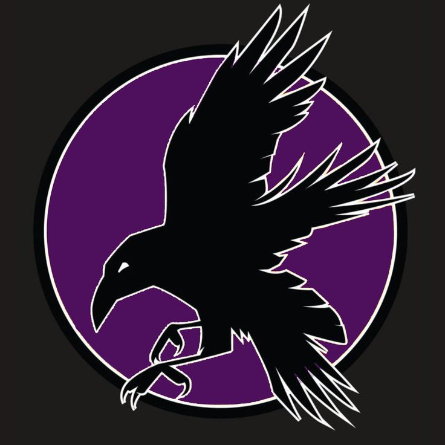

<p align="center">
  
</p>

<h1 align="center">AnimeAV1-Lite-CS</h1>

<p align="center">
  
  
  
  
</p>

---

A minimalist **AnimeAV1** extension and repository for **Cloudstream 3**, optimized for low RAM usage, fast loading, AniList integration, and compatibility with older Android TVs (`minSdk = 21`).

## 📥 Installing on Cloudstream 3

In **Cloudstream** → **Settings** → **Extensions** → **Add repository**, paste the **`repo.json`** URL:

```text
https://raw.githubusercontent.com/Jeishoon-bit/AnimeAV1-Lite-CS/main/repo.json
```

You can also open it using the direct link:

```text
cloudstreamrepo://raw.githubusercontent.com/Jeishoon-bit/AnimeAV1-Lite-CS/main/repo.json
```

## 🚀 Included optimizations

- **Selective DOM reading**: Avoids concatenating the entire document with `doc.text()` on long pages by reading only the metadata and information sections.
- **AniList GraphQL integration**: High-resolution covers, panoramic banners (`backgroundPosterUrl`), and ratings integrated automatically.
- **Strict categories**: Clean separation between *Latest*, *Ongoing*, *Movies*, and *OVAs*.
- **Safe parallel extractors**: Video extraction with `amap` is limited to 6 simultaneous threads to protect low-resource devices and older Android TVs.

## 🛠️ Local compilation of the `.cs3` plugin

```bash
gradle make makePluginsJson
```
