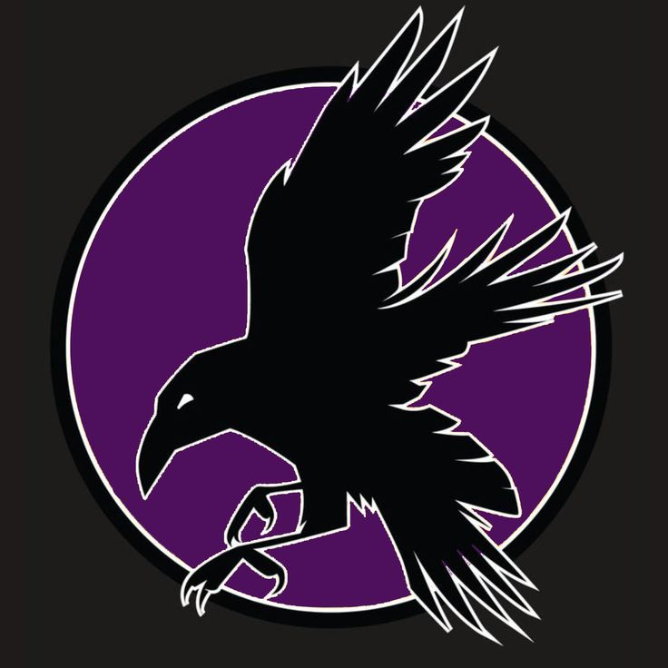

<p align="center">
  
</p>

<h1 align="center">AnimeAV1-Lite-CS</h1>

<p align="center">
  
  
  
  
</p>

---

Minimalist **AnimeAV1** extension and repository for **Cloudstream 3**, optimized for low RAM usage, fast loading, AniList integration, and compatibility with older Android TV devices (`minSdk = 21`).

## 📥 Installation in Cloudstream 3

In **Cloudstream** → **Settings** → **Extensions** → **Add repository**, paste the **`repo.json`** URL:

```text
https://raw.githubusercontent.com/Jeishoon-bit/AnimeAV1-Lite-CS/main/repo.json
```

You can also open it directly with the deep link:

```text
cloudstreamrepo://raw.githubusercontent.com/Jeishoon-bit/AnimeAV1-Lite-CS/main/repo.json
```

## 🚀 Included Optimizations

- **Selective DOM Reading**: Avoids concatenating the entire document with `doc.text()` on long detail pages, reading only the metadata and info sections.
- **AniList GraphQL Integration**: High-resolution covers, panoramic banners (`backgroundPosterUrl`), enriched synopses, and a next-episode airing countdown for ongoing anime.
- **Strict Categories**: Clean separation across *Latest Added*, *Ongoing*, *Movies*, *OVAs*, *Specials*, and *Most Popular*, plus full episode loading without the 50-episode cap on long-running series.
- **Safe Parallel Extractors**: Video extraction using `amap` capped at 6 concurrent threads to protect low-spec devices and older Android TVs.

## 🛠️ Local `.cs3` Plugin Build

```bash
gradle make makePluginsJson
```
